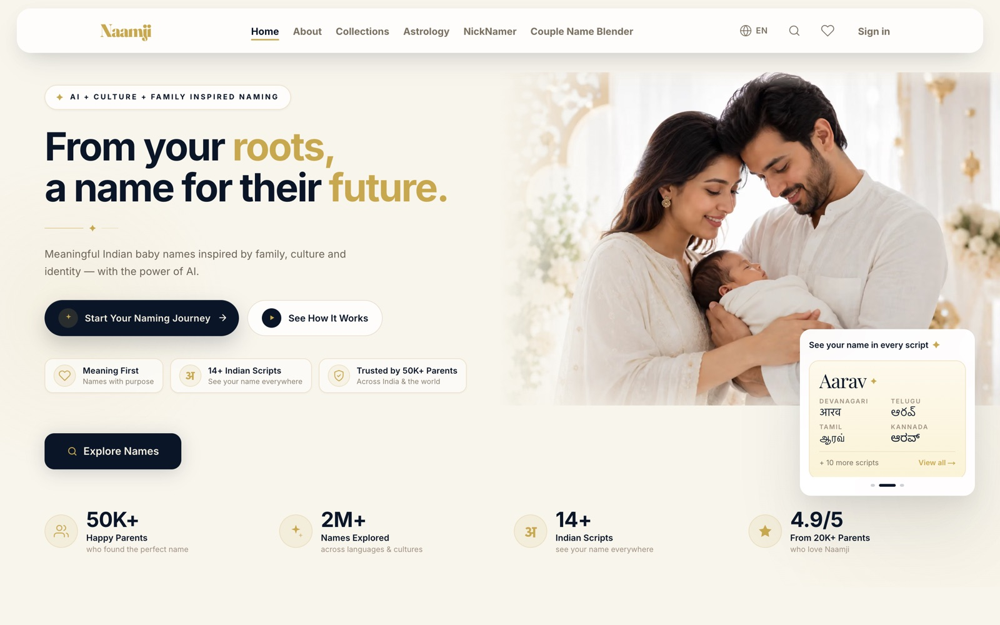
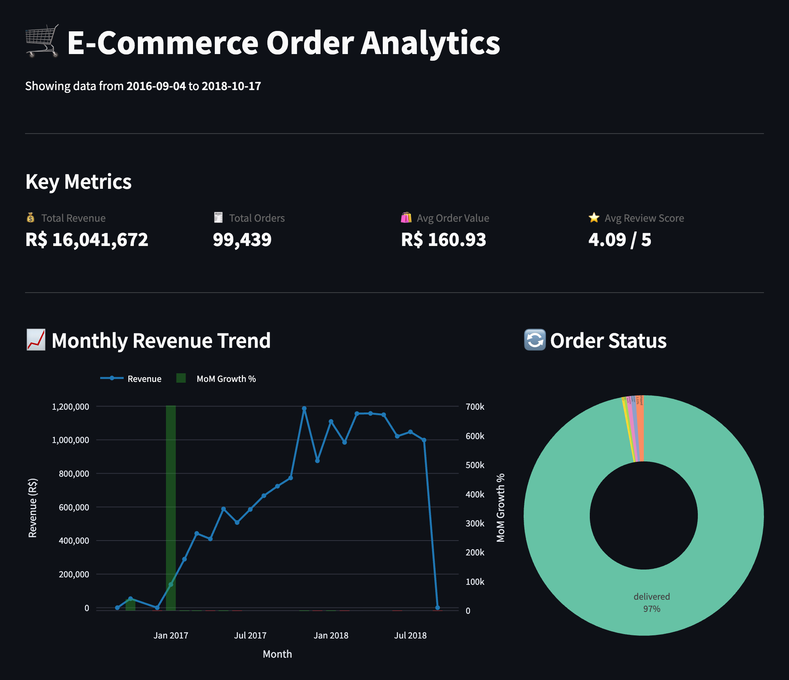

# Hi, I'm Shiva 👋

📍 Glasgow, UK &nbsp;·&nbsp; 🎯 Open to 2027 summer internships in Data Analytics, Data Science and ML

---

## 🧰 Tech stack

---

## 💼 Experience

### Data Analyst · [Swinfy Solutions](https://www.swinfy.com)

Core team member on **[Naamji](https://naamji.com)**, a live Indian baby-name platform with a 50,000-name catalogue.

- **Names data:** cleaned and structured the names catalogue and wrote the SQL behind it, so names can be filtered by religion, language, gender, rashi, Nakshatra, numerology and starting syllable
- **Backend:** fitted the data model into the app's Supabase (PostgreSQL) backend
- **Name cards:** designed and built every shareable name card, rendered dynamically for each name
- **Pages:** built the admin dashboard and the user pages, including profile, quiz results and shortlist sharing for family voting
- **Production support:** fixed bugs and errors on the live site

*The codebase is private company work; the product is live at [naamji.com](https://naamji.com).*

---

## 🚀 Featured project

### E-Commerce Order Analytics Platform

Raw e-commerce CSVs → normalised PostgreSQL database → tested dbt star schema → live BI dashboard.
A two-person project with [Khasim Shaik](https://github.com/Khasim0210): he built the 3NF database and ingestion (Phase 1); I built the analytics layer and the app (Phases 2 and 3).

<b>What I built</b> (click to expand)

 

- **dbt star schema:** a 112K-row fact table with 4 dimensions, guarded by 43 data quality tests
- **CI/CD:** GitHub Actions runs SQLFluff linting and dbt tests on every pull request
- **Advanced SQL:** CTEs and window functions (LAG, RANK, cumulative sums, cohort retention), tuned with indexes and `EXPLAIN ANALYZE`
- **Dashboard:** Streamlit + Plotly, 6 charts and 3 live filters, every chart querying the live Neon PostgreSQL database
- **Deployment:** Render, with continuous deployment from GitHub

<b>Data model</b> (click to expand)

 

---

## 📂 More projects

| Project | What it is | Stack |
|---|---|---|
| [**sql-notes**](https://github.com/Shivakrishnareddy-03/sql-notes) | A hand-written SQL reference, from `SELECT` basics to joins, subqueries and window functions. Each note has a worked example and a plain-words explanation. | SQL · Markdown |
| [**UK Data Job Market**](https://github.com/Shivakrishnareddy-03/uk-data-job-market) *(in progress)* | SQL analysis of 3,684 UK data-job salary records (2024–25): pay by role, seniority and company size, and how the UK compares with other markets. | SQLite · DBeaver |
| **Beru** *(private, in progress)* | A personal AI assistant with voice input and output, short- and long-term memory, and a FastAPI backend. | Python · FastAPI |

---

## 📈 Right now

- 🎓 MSc modules: Regression Models, Statistical Inference, Probability, Databases and R programming
- 📊 Finishing the UK Data Job Market analysis
- 🤖 Building Beru in my spare time

---

## 🐍 Contribution activity

<picture>
  <source media="(prefers-color-scheme: dark)" srcset="https://raw.githubusercontent.com/Shivakrishnareddy-03/Shivakrishnareddy-03/output/github-snake-dark.svg" />
  <source media="(prefers-color-scheme: light)" srcset="https://raw.githubusercontent.com/Shivakrishnareddy-03/Shivakrishnareddy-03/output/github-snake.svg" />
  
</picture>

*Thanks for stopping by!*

